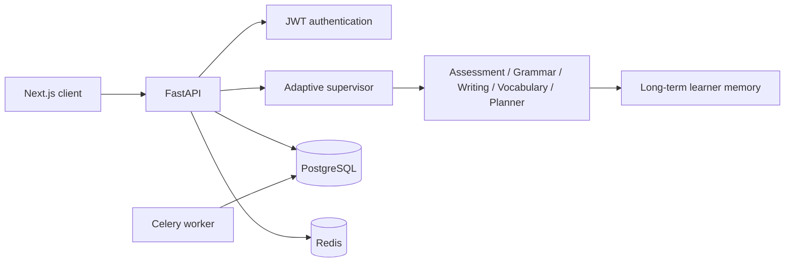

# Adaptive English Communication Coach

An enterprise AI mentor that helps professionals communicate clearly and confidently in English. It creates an evolving learning profile, daily learning plan, actionable corrections, and workplace-focused practice.

## Quick start

```bash
cp .env.example .env
docker compose up --build
```

Open `http://localhost:3000`; API documentation is at `http://localhost:8000/docs`.

For local development, run `uvicorn app.main:app --reload` from `backend` and `npm run dev` from `frontend`.

## Architecture



## Repository

- `backend/` FastAPI application, SQLAlchemy schema, adaptive workflow, API tests
- `frontend/` Next.js / TypeScript / Tailwind application
- `docs/` deployment, developer, and user guides
- `docs/Adaptive-English-Coach.postman_collection.json` importable API collection
- `.github/workflows/` CI checks

## Sample user

Run `python -m app.seed` inside `backend`. It creates `demo@coach.local` with password `DemoPass123!`.

## AI configuration

Set `OPENAI_API_KEY` to enable model-backed coaching. The system validates structured model outputs and falls back to deterministic, explainable coaching when unavailable. Never place keys in the browser; the backend alone reads them.

## Security notes

Passwords use bcrypt; tokens are signed JWTs; CORS is allowlisted; requests are validated through Pydantic; and a basic rate-limit middleware protects public endpoints. Use a strong `SECRET_KEY`, managed Postgres/Redis, TLS, and a production secret manager before deployment.
